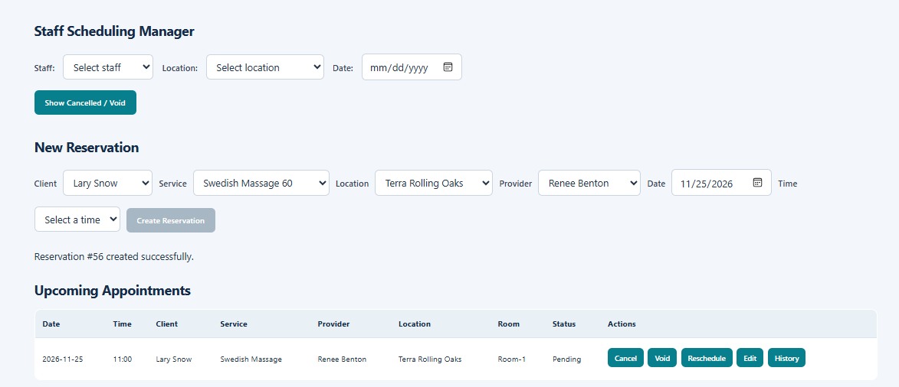
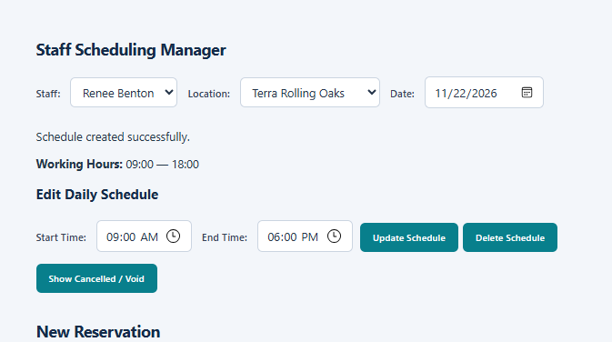

# SpaRes Modernization

**Full-Stack Reservation & Staff Scheduling Platform**

A full-stack web application modernizing a legacy commercial spa reservation system using **C#, ASP.NET Core Web API, React, TypeScript, Entity Framework Core, and SQLite**.

The project demonstrates end-to-end software engineering, including REST API development, relational data modeling, business-rule enforcement, frontend integration, and incremental delivery through functional vertical slices.

**Project Status:** Active development | Two implemented and locally tested vertical slices | Source code published on GitHub

## Technology Stack

**Backend**
- C# / ASP.NET Core Web API
- Entity Framework Core
- SQLite
- REST APIs
- Swagger / OpenAPI

**Frontend**
- React
- TypeScript
- Vite
- HTML / CSS
- Fetch API

**Development Tools**
- Visual Studio
- Visual Studio Code
- Git / GitHub

## Architecture

The application separates frontend presentation, backend business logic, and database access.

```text
React + TypeScript
        |
        | HTTP / JSON
        v
ASP.NET Core Web API
        |
        v
Entity Framework Core
        |
        v
SQLite Database
```

The backend implements REST endpoints and enforces reservation and scheduling business rules. The React frontend provides interactive interfaces for managing reservation and staff scheduling workflows.

## Implemented Vertical Slices

### 1. Reservation Management

Implemented and locally tested a full-stack reservation workflow.

**Key capabilities:**
- Create reservations through the React interface.
- Retrieve client, staff, service, and location data.
- Calculate available appointment times.
- Validate reservation conflicts and scheduling constraints.
- Manage reservation statuses.
- Expose REST API endpoints for reservation operations.

**Engineering highlights:**
- ASP.NET Core controllers and REST APIs.
- Entity Framework Core data access.
- DTOs for client-facing API responses.
- React and TypeScript integration.
- Server-side reservation validation.

### 2. Staff Scheduling & Availability

Implemented staff scheduling functionality integrated with reservation availability.

**Key capabilities:**
- Create daily staff schedules.
- Retrieve and update existing schedules.
- Delete daily schedules with server-side validation.
- Represent staff breaks and absences.
- Prevent schedule deletion when conflicting active reservations exist.

**Engineering highlights:**
- Date-specific scheduling using DateOnly and TimeOnly.
- REST endpoints for schedules, breaks, and absences.
- React scheduling management interface.
- Business-rule enforcement in backend controllers.
- HTTP 409 Conflict responses for blocked schedule deletions.

## Project Structure

```text
spares-modernization/
|
|-- SpaRes.Api/        # ASP.NET Core backend
|-- spares-web/        # React + TypeScript frontend
|-- README.md          # Project documentation
|-- .gitignore         # Git exclusions
```

## Running Locally

### Backend

1. Open the backend solution in Visual Studio.
2. Restore NuGet dependencies.
3. Configure the local SQLite database.
4. Run the ASP.NET Core Web API.
5. Open Swagger to inspect and test API endpoints.

Alternatively, from the repository root:

```bash
dotnet restore SpaRes.Api/SpaRes.Api.csproj
dotnet run --project SpaRes.Api/SpaRes.Api.csproj
```

### Frontend

From the repository root:

```bash
cd spares-web
npm install
npm run dev
```

Open the local URL displayed by Vite, typically `http://localhost:5173`.

The backend must be running for API-dependent functionality.

## Engineering Highlights

- **Full-stack ownership:** Implemented application functionality across React components, REST controllers, database entities, and validation logic.
- **Business-rule enforcement:** Applied server-side scheduling and reservation constraints to protect data consistency.
- **API design:** Developed REST endpoints and DTO-based responses for frontend consumption.
- **Incremental delivery:** Implemented and tested two functional vertical slices.
- **Legacy modernization:** Applied modern web architecture to a commercial Windows desktop software domain.

- ## Application Screenshots

### Reservation Management

Full-stack reservation workflow demonstrating appointment creation,
availability validation, and reservation management actions.



### Staff Scheduling & Availability

Manage date-specific staff schedules, working hours, and schedule updates through the React interface. Backend business rules protect schedules associated with active reservations.



## Development Status

**Completed development milestones:**
- Reservation Management vertical slice.
- Staff Scheduling vertical slice, including daily schedule creation, updates, and guarded deletion.
- Backend and frontend build validation.
- GitHub repository publication.

**Planned improvements:**
- Additional reservation and scheduling workflows.
- Automated testing coverage.
- Authorization and security review.
- Frontend usability improvements.
- Production deployment preparation.

The modernized application is currently a development and portfolio project, not a production deployment.

## Security

This repository is intended for development and portfolio demonstration.

Credentials, environment secrets, and local database files should not be committed to source control.

Production authorization and security hardening remain part of the development roadmap.

## Author

**Tony Bakhti**

Senior Software Developer | Full-Stack Engineer

[LinkedIn](https://www.linkedin.com/in/kouiderbakhti) | [Portfolio](https://www.kouiderbakhti.com)
